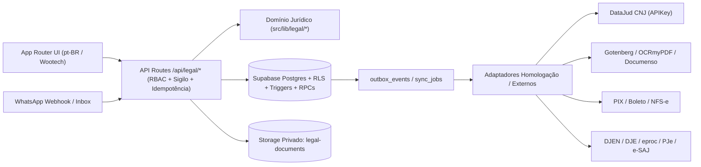
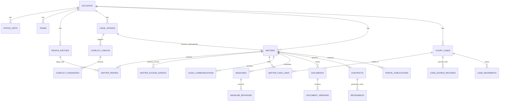

# Fase 0 — Arquitetura, Modelo Relacional, Matriz de Permissões e Contratos

## 1. Visão Arquitetural

O **WooJuris** estende o monólito modular Next.js 16 (App Router) + TypeScript + Supabase (Postgres, Auth, Storage, Realtime, RLS) com:

- **Módulos de domínio puros e testáveis (`src/lib/legal/`):** regras de negócio isoladas de I/O (RBAC/ABAC + sigilo, CNJ/DV, DataJud client/reconciliação, conflitos, prazos/calendários forenses, modelos/documentos/quarentena, contratos/assinaturas, financeiro em centavos/reconciliação, portal, relatórios/CSV, IA assistiva com citações).
- **Motor de persistência híbrido com RLS + API Routes (`src/app/api/legal/`):** toda mutação e leitura sensível passa por guarda de sessão + RBAC + sigilo + trilha de auditoria (`audit_events`) e `outbox_events` para efeitos externos.
- **Modo Homologação / Fixtures Sintéticas:** quando credenciais externas (DataJud, Documenso, Gotenberg, OCR, PIX/NFS-e) não estão configuradas, o sistema sinaliza explicitamente o status `homologacao` ou `indisponivel` e oferece os fluxos manuais auditáveis completos.

---

## 2. Modelo Relacional (Reconciliação com WACRM)

### 2.1 Entidades Reaproveitadas do WACRM
- `accounts` (estendida com `brand_name`, `oab_society_number`, `cnpj`, `timezone` IANA padrão `America/Sao_Paulo`, `saas_plan`, `oab_compliance_mode`, `ai_autonomous_disabled`, `mcp_enabled`, `broadcasts_enabled`).
- `profiles` (estendida com `legal_role`, `oab_number`, `oab_uf`, `unit_id`, `mfa_required`, `is_platform_ops`).
- `contacts`, `conversations`, `messages`, `pipelines`, `pipeline_stages`, `deals`, `notifications`, `whatsapp_config`.

### 2.2 Novas Entidades Jurídicas e Ordem de Migrations

| Migration | Escopo | Tabelas / Objetos |
| --- | --- | --- |
| `061_legal_identity_governance.sql` | Identidade, unidades, equipes, papéis jurídicos, auditoria imutável, governança LGPD/OAB e acesso excepcional SaaS | `legal_role_enum`, alterações em `accounts` e `profiles`, `office_units`, `teams`, `team_members`, `role_permission_grants`, `break_glass_grants`, `audit_events` (append-only), `retention_holds`, `data_subject_requests`, `saas_subscriptions`, funções `current_legal_role()`, `has_legal_permission()`, `log_legal_audit()` |
| `062_legal_intake_clients_conflicts.sql` | Pessoas PF/PJ, partes, triagem/oportunidades, consultas, verificação de conflitos e conversão idempotente | `people_entities`, `entity_relationships`, `legal_intakes`, `appointments`, `conflict_checks`, `conflict_candidates`, alterações em `contacts`/`whatsapp_config` (múltiplos números por escritório) |
| `063_legal_matters_checklists.sql` | Pastas jurídicas (judiciais e extrajudiciais), barreiras de sigilo, equipe da pasta, partes e checklists versionados | `matters`, `matter_members`, `matter_access_grants`, `matter_parties`, `checklist_templates`, `checklist_template_versions`, `matter_checklists`, função `can_access_matter(UUID)` com precedência absoluta de sigilo, RPC `convert_intake_to_matter(...)` |
| `064_legal_cases_datajud_communications.sql` | Processos, vínculo N:N pasta↔processo, fontes externas (DataJud/manuais), movimentos deduplicados, central de comunicações, protocolos, calendários, prazos e agenda | `court_cases`, `matter_case_links`, `case_source_records`, `case_movements`, `legal_communications`, `court_calendars`, `calendar_exceptions`, `deadlines`, `deadline_revisions`, `hearings`, `legal_tasks`, `protocols` |
| `065_legal_documents_contracts_portal.sql` | Repositório documental com quarentena e versões, modelos versionados, contratos, assinaturas, webhooks anti-replay e portal do cliente | `documents`, `document_versions`, `document_templates`, `document_template_versions`, `contracts`, `contract_versions`, `signature_requests`, `signature_events`, `portal_invitations`, `portal_publications`, bucket privado `legal-documents` + RLS |
| `066_legal_finance_ops_imports.sql` | Financeiro em centavos (`BIGINT`), conta escritório vs conta de terceiros, conciliação, prestação de contas, integrações, filas outbox/inbox, sync jobs e importação CSV com rollback | `fee_terms`, `client_fund_accounts`, `receivables`, `installments`, `ledger_entries`, `expenses`, `payments`, `settlement_allocations`, `reconciliation_runs`, `integration_connections`, `sync_jobs`, `inbox_events`, `outbox_events`, `csv_import_batches`, `ai_assist_logs`, RPC `generate_contract_receivables(...)` |

### 2.3 Diagrama Entidade-Relacionamento (Núcleo)

---

## 3. Matriz de Permissões (RBAC + ABAC + Sigilo)

### 3.1 Precedência de Regras
1. **Isolamento de Escritório (`account_id`):** absoluto em todas as tabelas e storage.
2. **Barreira de Sigilo (`matters.is_restricted = true`):** **PRECEDÊNCIA ABSOLUTA**. Mesmo `partner_admin` ou `owner` recebe `403 Forbidden` / zero linhas em SQL, busca, anexos e exportações se não possuir grant ativo em `matter_access_grants` (ou `matter_members` ativo).
3. **Acesso Excepcional SaaS (`platform_ops`):** negado por padrão em dados jurídicos; só liberado com `break_glass_grants` válido (autorizador, motivo, janela de tempo limitada e auditoria obrigatória).
4. **Escopo granular:** `account` → `unit` → `team` → `matter` → `item` (`confidentiality_level`: `publico_portal`, `interno`, `restrito`, `sigiloso`).

### 3.2 Matriz por Perfil

| Recurso / Ação | `platform_ops` | `partner_admin` | `coordinator` | `lawyer` | `assistant` | `reception` | `finance` | `client` | `auditor` |
| --- | :---: | :---: | :---: | :---: | :---: | :---: | :---: | :---: | :---: |
| Assinatura SaaS / Saúde Plataforma | RW | R (própria) | — | — | — | — | — | — | R (mandato) |
| Configurações / Equipe / Unidades | — (break-glass) | RW | R | R (próprio) | R (próprio) | R (próprio) | R (próprio) | — | R |
| Atendimento / Inbox / Triagem / Agenda Consulta | — | RW | RW | RW (atribuído) | RW (atribuído) | RW | — | — | R |
| Conflitos (Consulta / Decisão / Exceção) | — | RW + Aprovar | RW + Aprovar | R + Solicitar | R + Solicitar | Solicitar | — | — | R |
| Pastas Jurídicas (não restritas) | — (break-glass) | RW | RW | RW (autorizadas) | RW (minutas/tarefas) | R (resumo) | R (mínimo) | — | R |
| Pastas Restritas (`is_restricted=true`) | — (break-glass) | **Somente com grant** | **Somente com grant** | **Somente com grant** | **Somente com grant** | — | — | — | **Somente com mandato** |
| Estratégia Jurídica / Notas Sigilosas | — | Grant | Grant | Grant | — | — | — | — | — |
| Processos / DataJud / Protocolos | — | RW | RW | RW | R + rascunho | — | — | — | R |
| Comunicações Oficiais & Prazos (Validar) | — | RW + Validar | RW + Validar | RW + Validar | R + rascunho | — | — | — | R |
| Documentos & Modelos (Aprovar / Publicar) | — | RW + Aprovar | RW + Aprovar | RW + Aprovar | Upload / Minuta | — | Comprovantes | Publicados | R |
| Contratos & Assinaturas | — | RW + Aprovar | RW | RW (minuta/revisão) | Rascunho | Proposta | R | Assinar/Ver próprio | R |
| Financeiro / Prestação de Contas | — | RW + Estorno | R | R (próprias pastas) | — | Proposta | RW + Conciliar | Próprias cobranças | R + Exportar |
| Portal do Cliente (Publicar / Revogar) | — | RW | RW | RW (aprovado) | — | — | Cobranças | Leitura + Envio seguro | R |
| Auditoria / Exportações / DSAR | Plataforma | RW | R (equipe) | R (pasta) | — | — | R (financeiro) | Próprios dados | R + Exportar |

---

## 4. Contratos de Integração e Modos de Operação

| Integração | Variáveis (sem segredos) | Contrato | Estado sem credenciais |
| --- | --- | --- | --- |
| **DataJud CNJ** | `DATAJUD_API_KEY`, `DATAJUD_BASE_URL`, `DATAJUD_TIMEOUT_MS`, `DATAJUD_MAX_CONCURRENCY` | `POST /{alias}/_search` com `Authorization: APIKey <key>`, filtro `match`/`term` em `numeroProcesso` (20 dígitos), respeito a `Retry-After`, backoff com jitter | **Modo Homologação** com fixtures oficiais sintéticas para `TJSC`, `TRF4`, `TRT12` + cadastro manual completo |
| **DJEN / DJE / eproc / PJe / e-SAJ** | `JUDICIAL_CONNECTORS_ENABLED` | Adaptadores independentes por tribunal; captura automática com ciência **bloqueada por padrão** | **Indisponível / Homologação** — entrada manual, upload de recorte/PDF e link oficial |
| **Gotenberg (DOCX→PDF)** | `GOTENBERG_URL`, `GOTENBERG_AUTH_TOKEN` | `POST /forms/libreoffice/convert` e `/forms/chromium/convert/html` | **Homologação** — geração de HTML imprimível/PDF client-side + registro de versão |
| **OCRmyPDF (Worker)** | `OCR_WORKER_URL`, `OCR_WORKER_TOKEN` | Job assíncrono (`sync_jobs`) com `lang=por`, preserva arquivo original intacto e grava derivado pesquisável | **Indisponível / Homologação** — fila registrada com status `homologacao_pendente` |
| **Documenso (Assinatura)** | `DOCUMENSO_API_URL`, `DOCUMENSO_API_KEY`, `DOCUMENSO_WEBHOOK_SECRET` | Envio de envelope, webhook com HMAC + anti-replay (`inbox_events`), download de arquivo final + trilha | **Homologação** — **formalização manual auditável** com upload de comprovante/hash |
| **PIX / Boleto / NFS-e** | `BILLING_PROVIDER`, `BILLING_API_KEY`, `NFSE_PROVIDER`, `NFSE_MUNICIPALITY_CODE` | Separação estrita entre emissão, pagamento e conciliação bancária | **Homologação** — pagamento manual, baixa parcial, estorno e conciliação OFX/CSV revisável |
| **IA Assistiva Jurídica** | `AI_REQUEST_TIMEOUT_MS`, BYO key criptografada por conta | Extração/resumo/minuta **sempre citando arquivo, versão e página/registro**; revisão humana obrigatória; zero telemetria com conteúdo confidencial | **Homologação / Manual** — bots autônomos e MCP desabilitados por padrão |
